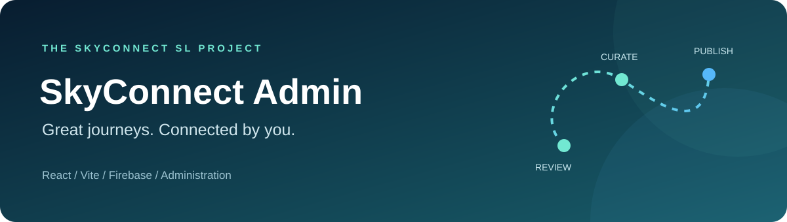
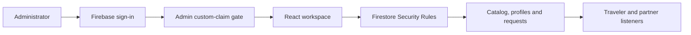

<p align="center">
  
</p>

<p align="center">
  <strong>The administration workspace for SkyConnect SL.</strong><br />
  Review partners, curate published travel content and oversee connected service requests.
</p>

<p align="center">
  
  
  
  
  
</p>

<p align="center">
  <a href="#overview">Overview</a> &middot;
  <a href="#features">Features</a> &middot;
  <a href="#architecture">Architecture</a> &middot;
  <a href="#quick-start">Quick start</a> &middot;
  <a href="#configuration">Configuration</a> &middot;
  <a href="#testing">Testing</a> &middot;
  <a href="#roadmap">Roadmap</a>
</p>

## Overview

**SkyConnect Admin** is the React + Vite website for partner verification, listing/route moderation, destination and package management, and traveler plan/service-request visibility.

Firebase Authentication supplies the administrator session. The interface requires the **`admin: true` custom claim**, reads records through Firestore listeners and persists authorized edits. Deployed Firestore Rules must also enforce administrator permissions; a frontend login gate is not sufficient by itself.

> **Repository status - 14 November 2026:** Firebase-backed administration and review workflows exist in source. Production deployment, complete connected-account acceptance and measured engagement tracking remain unfinished. This is no longer a demo-only dashboard; sample catalog records may still appear.

## Features

| Workspace | Implemented behavior |
| --- | --- |
| Administrator session | Email/password sign-in, claim-based gate and account switching |
| Overview | Record counts, review queues and available likes/saves activity |
| Partner verification | Airline/tourism sections, request dates and submitted-detail dialogs |
| Flight routes | Airport, schedule, aircraft and cabin details with review actions |
| Offers and experiences | Listing moderation and content editing |
| Destinations and packages | Catalog creation/editing and publication management |
| Trips and requests | Saved-plan/request visibility, grouped service details and CSV export |
| Users and partners | Searchable directory with category/status views |
| Notifications | Inbox, registration code and web push integration points |
| Privacy route | Public account-deletion request interface |

Platform approval is not aviation/tourism regulator certification. Untracked impressions and sample content must not be presented as measured production activity.

## Architecture



The Firebase backend owns Rules, indexes and trusted claim provisioning. The AI backend is a separate service; an AI URL setting does not mean this dashboard implements a working AI-management feature.

## Technology stack

| Technology | Role |
| --- | --- |
| React 19 | Workspace screens and component state |
| Vite 6 | Development server and production build |
| Firebase Web SDK | Authentication, Firestore and messaging integration |
| Lucide React | Interface icons |
| Recharts | Available chart views |
| CSS | Responsive layouts, themes and dialogs |
| Node test runner | Submitted application/route detail helper tests |

See [package.json](package.json) and the lockfile for actual dependency ranges.

## Quick start

Use Node.js **22.13+**, npm, Git and the same Firebase project as the mobile apps.

```powershell
git clone --branch feature/new-updates https://github.com/ChamiduPrabodya/SkyConnect-SL-Admin-Web-App.git
cd SkyConnect-SL-Admin-Web-App
npm.cmd ci

# First setup only; keep an existing .env intact.
if (!(Test-Path .env)) { Copy-Item .env.example .env }

# Fill Firebase Web App configuration before signing in.
npm.cmd run dev -- --port 5173
```

Open **http://localhost:5173** or the URL Vite prints if that port is occupied. Restart Vite after changing environment variables.

### Administrator access

1. Enable email/password sign-in and create the intended Firebase Authentication account.
2. In the separate Firebase backend, provision its UID using an authorized identity:

   ```powershell
   $env:GOOGLE_CLOUD_PROJECT = 'YOUR_FIREBASE_PROJECT_ID'
   npm.cmd run admin -- YOUR_ADMIN_AUTH_UID --firebase-cli
   ```

3. Sign out and back in to refresh the custom claim.
4. Deploy and verify restrictive Firestore Rules from the Firebase backend.

An ordinary registered account cannot become an administrator by editing this frontend. There is no shared demo password.

## Configuration

Use [.env.example](.env.example) with the Firebase **Web App** configuration.

| Variables | Purpose |
| --- | --- |
| `VITE_FIREBASE_API_KEY`, `VITE_FIREBASE_AUTH_DOMAIN` | Firebase client/sign-in configuration |
| `VITE_FIREBASE_PROJECT_ID`, `VITE_FIREBASE_APP_ID` | Shared project and registered web application |
| `VITE_FIREBASE_STORAGE_BUCKET` | Media bucket configuration |
| `VITE_FIREBASE_MESSAGING_SENDER_ID`, `VITE_FIREBASE_VAPID_KEY` | Web messaging configuration |
| `VITE_AI_API_BASE_URL` | Separate AI-service base URL; not a Vertex secret |
| `VITE_FIREBASE_USE_EMULATORS=true` | Optional local Auth/Firestore routing supported by the initializer |
| `VITE_FIREBASE_EMULATOR_HOST` | Optional emulator host; default `127.0.0.1` |

All `VITE_*` values are bundled into browser code. Keep service-account credentials, private keys and Vertex API keys on trusted servers.

## Connected workflow

1. A partner registers and submits business information in the Partner app.
2. An administrator reviews the submitted profile and changes its review state.
3. The partner submits a route, stay or tour for moderation.
4. An administrator reviews its submitted fields and publishes or rejects the record.
5. Traveler catalog views read published records; selected service requests go to their providers.
6. Provider decisions and administrator edits propagate through shared Firestore records.

Partner approval, content publication and provider request confirmation are separate actions. Approving a partner does not automatically confirm a traveler's request.

## Testing

```powershell
node --test tests/partner-application.test.js tests/flight-route-details.test.js
npm.cmd run build
npm.cmd run preview
```

Vite builds into `dist/`. A successful build does not verify deployed Rules, real notification delivery or cross-account authorization.

## Project structure

```text
SkyConnect-SL-Admin-Web-App/
|-- docs/assets/banner.svg       # Repository artwork
|-- src/
|   |-- AdminSession.jsx         # Session and administrator gate
|   |-- firebase.js              # Firebase initialization / emulator routing
|   |-- firestoreService.js      # Catalog and status writes
|   |-- App.jsx                  # Workspace shell, listeners and navigation
|   |-- PartnerProfiles.jsx      # Partner review
|   |-- FlightRoutesPage.jsx     # Route review workflow
|   |-- FlightRouteReviewModal.jsx
|   |-- CatalogPage.jsx          # Destination/package management
|   |-- TripsPage.jsx            # Saved plans and service requests
|   |-- tripsView.js             # Trip presentation and CSV export
|   |-- notifications/           # Inbox and web push integration
|   `-- privacy/                 # Public deletion-request interface
|-- public/                      # Branding, catalog images and messaging worker
`-- tests/                       # Detail-mapping regression tests
```

## Roadmap

- [x] Firebase session gate and administrator custom-claim checks
- [x] Partner, listing and flight-route review workflows
- [x] Catalog editing and saved-plan/request visibility
- [x] Submitted detail dialogs and CSV export
- [ ] Verify connected workflows against deployed Rules
- [ ] Complete engagement tracking and required export coverage
- [ ] Finish web push acceptance and deletion verification
- [ ] Complete accessibility, production hosting and user acceptance testing

## Related repositories

| Repository | Responsibility |
| --- | --- |
| [Firebase backend](https://github.com/ChamiduPrabodya/SkyConnect-Backend-Firebase) | Rules, indexes, claim provisioning and trusted processing |
| [Traveler app](https://github.com/ChamiduPrabodya/SkyConnect-user-app) | Discovery, planning and traveler requests |
| [Partner app](https://github.com/IT24101654/SkyConnect-partner-app) | Airline/tourism registration and provider workflows |
| [AI backend](https://github.com/IT24101654/SkyConnect-AI-Backend) | Skylo conversational service |

## Development and licensing

Preserve catalog attribution in [public/destinations/CREDITS.txt](public/destinations/CREDITS.txt). No open-source license has been selected in this repository; do not assume an MIT grant.

<p align="center"><strong>SkyConnect SL &middot; Great journeys. Connected by you.</strong></p>
